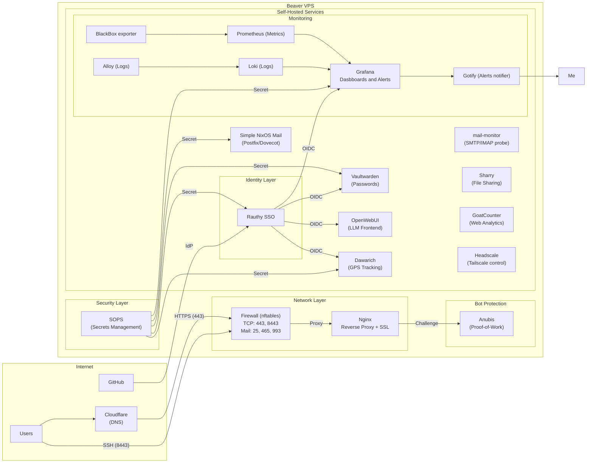
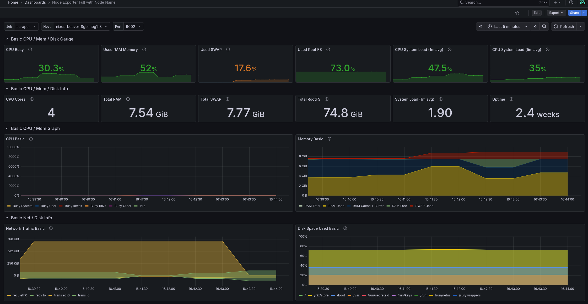
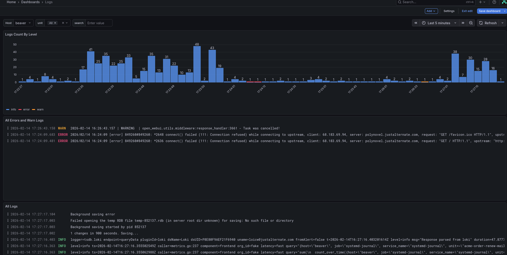
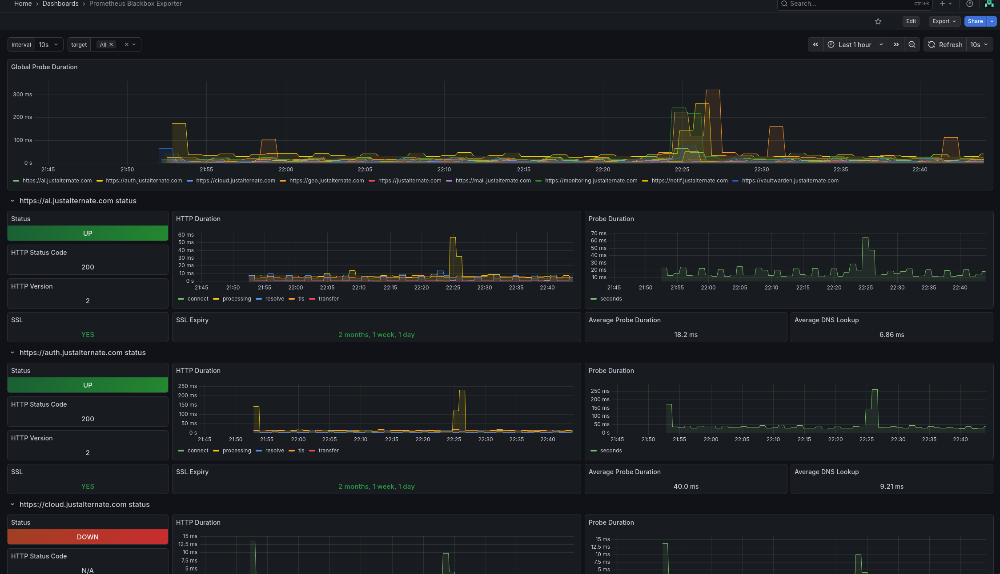
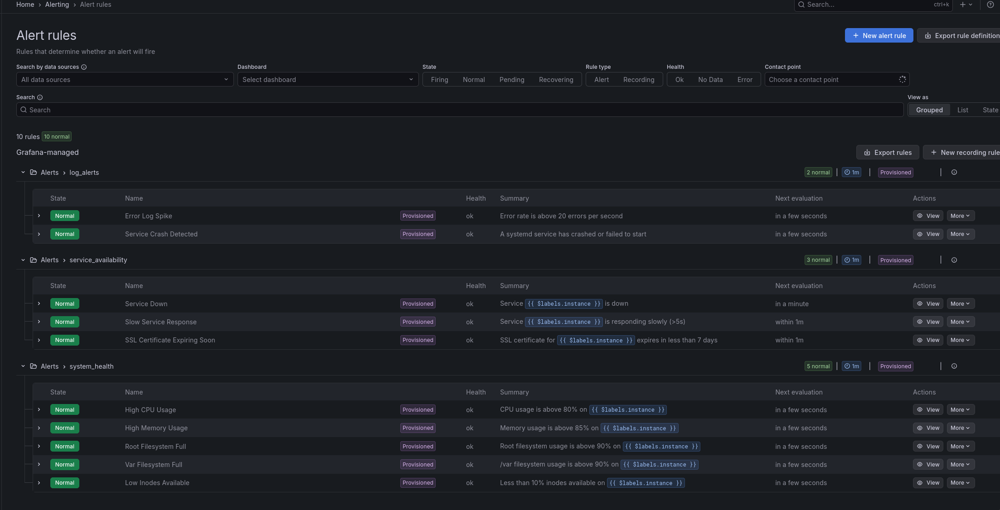
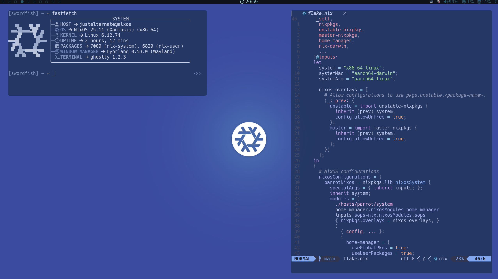
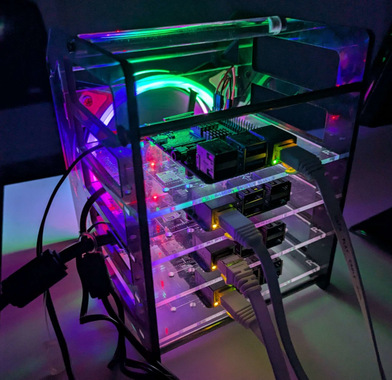

# nixcfg

This repository contains the declaration of my systems running [Nix/NixOS](https://nixos.org/)

- 🦫 beaver: My VPS running NixOS and selfhosting services.
- 🐟 swordfish: My Desktop running NixOS desktop. (login only through yubikey)
- 🦜 parrot: My Laptop running NixOS. (login only through yubikey)
- 🦅 eagle: My TUXEDO InfinityBook Pro 14 laptop running NixOS. (FIDO2 LUKS unlock + yubikey login)
- 🦎 gecko: My NixOS Raspberry Pi cluster (3x pi3b+ and 1x pi4)

### Features

#### CI/CD

- **GitHub Actions**: `nix flake check`, nixfmt, statix, deadnix, and SOPS validation on every push and PR

#### VPS (beaver)
- Identity management : [Rauthy](https://github.com/sebadob/rauthy) (with SSO using github provider or passkey/yubikey)
- Reverse proxy & web server: [nginx](https://nginx.org/en/)
- Anti-bot/scraper protection: [Anubis](https://anubis.techaro.lol) (proof-of-work challenge)
- Monitoring (observability) : [Grafana](https://github.com/grafana/grafana) (only accessible through Rauthy)
- Monitoring (metric collector): [Prometheus](https://github.com/prometheus/prometheus)
- Monitoring (logs aggregator): [Loki](https://github.com/grafana/loki)
- Monitoring (Alerts notification): [Gotify](https://github.com/gotify/server)
- Mail server: [Simple nixos mail server](https://gitlab.com/simple-nixos-mailserver/nixos-mailserver)
- Mail end-to-end probe: [mail-monitor](hosts/beaver/system/services/mail-monitor) (SMTP/IMAP round-trip health check)
- Password management: [Vaultwarden](https://github.com/dani-garcia/vaultwarden) (only accessible through Rauthy)
- LLM frontend : [openwebui](https://github.com/open-webui/open-webui) (only accessible through Rauthy)
- Sharing gps location service: [Dawarich](https://github.com/Freika/dawarich)
- File sharing: [Sharry](https://github.com/eikek/sharry)
- Web analytics: [GoatCounter](https://www.goatcounter.com/)
- VPN mesh coordination: [Headscale](https://github.com/juanfont/headscale) (self-hosted Tailscale control server)
- Security: sops-nix (secrets management), Fail2Ban (intrusion prevention)
- Binary cache: [Cachix](https://cachix.org) (`justalternate-nixcfg.cachix.org`)
- Backups: [Restic](https://restic.net/) twice-weekly snapshots (Mon, Thu) to Hetzner Storage Box (SFTP), with PostgreSQL dumps, pruning (7d/4w/6m), and integrity checks. See [RUNBOOK](hosts/beaver/system/services/backups/RUNBOOK.md) for recovery.

##### Infrastructure Overview (Beaver VPS)



#### Monitoring Dashboards :

##### Node exporter 



##### Logs



##### Status, Probe and TLS certificates



##### Alerting



#### Desktop (swordfish, parrot and eagle)
- DE: [Hyprland](https://hyprland.org/)
- Terminal: [Ghostty](https://ghostty.org/)
- Bar: [Waybar](https://github.com/Alexays/Waybar)
- File Manager: [yazi](https://yazi-rs.github.io/)
- Editor: Neovim [justnixvim](https://github.com/JustAlternate/justnixvim)
- Fetcher: [fastfetch](https://github.com/fastfetch-cli/fastfetch)
- Font: [nerdfonts](https://www.nerdfonts.com/)
- Launcher: [rofi](https://github.com/A417ya/rofi-wayland)
- Browser: [librewolf](https://librewolf.net/)
- Discord: [Vesktop](https://github.com/Vencord/Vesktop)
- Emoji wheel: rofi + [bemoji](https://github.com/marty-oehme/bemoji)
- Music Visualizer: [cava](https://github.com/karlstav/cava)
- Dynamic theming: wallpaper-driven colors via [pywal](https://github.com/dylanaraps/pywal) + [swww](https://github.com/LGFae/swww)
- Notifications: [dunst](https://dunst-project.org/)
- Screenshots: [grim](https://github.com/emersion/grim) + [slurp](https://github.com/emersion/slurp) + [satty](https://github.com/gabm/satty)
- Secrets: [sops-nix](https://github.com/Mic92/sops-nix)
- Yubikey only login with automatic screen lock when not detected. 



#### NixOS Raspberry Pi cluster

- 4 Pi (3x Pi 3B+, 1x Pi 4B) on static IPs (192.168.1.11-14)
- **Management**: SSH access from main machine, SD image builder for initial deployment
- **Network**: connected via Tailscale client mesh network with a VPS running Headscale as the coordination server



### 🔐 Security & Access Management

Since this repository is fully public, I highly value security principles, here are what I implemented and my general direction about it :

**Secrets Management**
- **SOPS-Nix**: Encrypted via `age` using keys derived from SSH keys
- **Vaultwarden**: Self-hosted credential management

**Identity & Access Management**
- **Rauthy**: Centralized IdP enforcing OIDC across services
- **SSO Providers**: GitHub OAuth, WebAuthn (YubiKey)

**Authentication Architecture**
- **Host Access (Desktops)**: Single-factor hardware authentication via PAM U2F (YubiKey) with automatic screen lock on removal
- **Remote Access (VPS)**: SSH with Ed25519 keys (password authentication disabled)
- **Service Access**: OIDC via Rauthy

**Note on MFA**: Currently relying on possession-factor authentication (YubiKey for local, SSH keys for remote). Planning to add biometrics (inherence factor) to achieve true 2FA for local access.

**Network Hardening**
- Firewall: nftables with minimal port exposure (443, 8443, 25, 465, 993)
- Fail2Ban: Automated intrusion prevention

## Installation

Enter a shell with git and vim.
```
nix-shell -p git vim
```

Clone the repository and enter it
```
git clone https://github.com/JustAlternate/nixcfg
cd nixcfg
```

Create your host directory with a `system/` (OS-level) and `home/` (Home Manager) entry
point, following the layout of the existing hosts (see `AGENTS.md`):
```
mkdir -p hosts/<myMachineName>/{system,home}
```

Create your hardware config
```
nixos-generate-config --show-hardware-config > hosts/<myMachineName>/system/hardware.nix
```

Write the system configuration (import the shared profiles/modules plus `./hardware.nix`)
```
vim hosts/<myMachineName>/system/default.nix
```

Write the home configuration (import the shared `../../../home` bundle)
```
vim hosts/<myMachineName>/home/default.nix
```

Modify the flake.nix to add your machine with the `mkHost` helper
```
vim flake.nix
```

Temporary activate flakes experimental features and rebuild switch
```
NIX_CONFIG="experimental-features = nix-command flakes"
sudo nixos-rebuild switch --flake .#<myMachineName>Nixos
```

## Advanced Install process (optional)

Create a `.ssh` folder and populate it with your ssh private key
```
mkdir -p ~/.ssh
ssh-keygen -t ed25519 -C "email@email.com"
```

Create your sops age private key
```
sudo mkdir -p /root/.config/sops/age
sudo nix-shell -p ssh-to-age --run "ssh-to-age -private-key -i ~/.ssh/id_ed25519 > /root/.config/sops/age/keys.txt"
```
